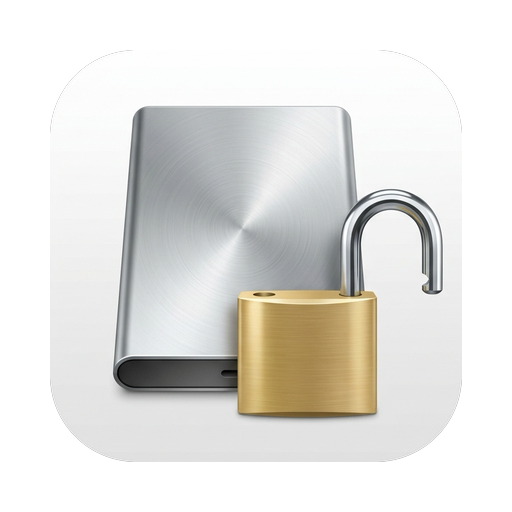

<p align="center"></p>

# dislocker-ui

[](https://github.com/kgrizz-git/dislocker-ui/actions/workflows/ci.yml)
[](https://sonarcloud.io/summary/new_code?id=kgrizz-git_dislocker-ui)
[](LICENSE)


A small macOS GUI for mounting BitLocker drives with
[dislocker](https://github.com/Aorimn/dislocker). It does **not** reimplement
BitLocker crypto. It drives an installed `dislocker-fuse`, then mounts the
decrypted image (NTFS via ntfs-3g, FAT/ExFAT via the system mount helpers).

**Version:** see [`VERSION`](VERSION) · [Changelog](CHANGELOG.md) ·
[Security](SECURITY.md) · [Contributing](CONTRIBUTING.md)

## What it does

1. Unlock a BitLocker volume with a user password, recovery password, or `.bek` file.
2. Mount the decrypted image under `/Volumes` (read-only by default): **ntfs-3g**
   for NTFS, system **mount_msdos** / **mount_exfat** for BitLocker To Go FAT/ExFAT.
3. Unmount cleanly (volume → detach raw disk → unmount FUSE).

## Quick start

1. Install the dependencies ([Installation](#installation), sections 1–4).
2. Double-click **`dislocker-ui.command`** in Finder. Terminal opens and asks
   for your admin password. (Or run `sudo ./run.sh` from the repo root.)
   The first launch also gives the launcher its Finder icon.
3. Pick the drive, enter the password or recovery key, and click **Mount**.
4. Click **Unmount** before you eject the drive. Keep the Terminal window
   open while the app runs, because closing it ends the app.

### Why sudo?

macOS privacy controls (TCC) block an unprivileged GUI from opening removable
`/dev/disk*` devices, so the app must already run as root. The gate keys on
launch context, not uid. A `.app` that elevates through an osascript
administrator prompt is denied even as root, even with Full Disk Access
(measured 2026-10-17; see
[`plans/double-clickable-app.md`](plans/double-clickable-app.md)). A
Terminal-attached `sudo` works, which is why the launcher is a `.command`.
The `.command` needs macOS 12.3+; on older systems use `sudo ./run.sh`.

`run.sh` executes the **checkout** as root (`PYTHONPATH=…/src`). Keep the repo
owned by you and not group-/world-writable, and do not `sudo` a shared or
untrusted tree. Both launchers refuse a writable tree.

Mounts support physical BitLocker devices (`/dev/diskN` or `/dev/diskNsM`)
only. Regular image files are out of scope.

## Requirements

| Dependency | Required? | Role |
|------------|-----------|------|
| macOS | Yes | Target platform (12.3+ for the double-click `.command`) |
| Python 3.10+ with tkinter | Yes | GUI |
| [dislocker](https://github.com/Aorimn/dislocker) | Yes | BitLocker unlock (`dislocker-fuse`) |
| [macFUSE](https://osxfuse.github.io/) ≥4.10 | Yes | Required for dislocker + ntfs-3g options used here (`allow_other` / `local` / uid). Must provide a `fuse3` pkg-config entry. |
| **`ntfs-3g`** | **Yes** (for NTFS) | RO and RW NTFS mounts (kernel `mount_ntfs` is missing on recent macOS). FAT/ExFAT BitLocker To Go uses system `mount_msdos` / `mount_exfat`. |

This project does **not** bundle FUSE or ntfs-3g (system extensions / installers).

## Installation

### 1. Homebrew

If needed: https://brew.sh

### 2. FUSE backend (required)

**macFUSE** is required for the Homebrew macOS formulae below. After install,
approve the system extension in **System Settings → Privacy & Security**, then
reboot if macOS asks.

```bash
brew install --cask macfuse
```

(`brew install --cask` needs an interactive Terminal for `sudo`. You can also
open the `.dmg` from the Homebrew cache and run **Install macFUSE.pkg**.)

### 3. dislocker + ntfs-3g (macOS Homebrew)

The Homebrew build below satisfies the **GUI preflight check** only; the
elevated mount flow requires root-owned binaries. Run
`scripts/install-root-deps.sh` once (section 4) to satisfy both.

Homebrew core’s `dislocker` / `ntfs-3g` formulae are awkward on modern macOS
(no bottles / FUSE disabled). Use the community macFUSE tap:

```bash
brew tap gromgit/homebrew-fuse
# Newer Homebrew may require:
#   brew trust --formula gromgit/fuse/dislocker-mac
#   brew trust --formula gromgit/fuse/ntfs-3g-mac
brew install gromgit/fuse/dislocker-mac
brew install gromgit/fuse/ntfs-3g-mac   # required for mounts on modern macOS
```

Confirm:

```bash
which dislocker-fuse
dislocker-fuse -h | head
which ntfs-3g
ntfs-3g --version
```

If `dislocker-fuse` fails with a missing `libmbedcrypto.16.dylib`, the bottle
was built against mbedtls 3.x while Homebrew linked mbedtls 4.x. Fix:

```bash
brew install mbedtls@3
ln -sf /opt/homebrew/opt/mbedtls@3/lib/libmbedcrypto.16.dylib \
  /opt/homebrew/opt/mbedtls/lib/libmbedcrypto.16.dylib
```

(That symlink can break on `brew upgrade`; re-run if dislocker stops loading.)

Then click **Recheck deps** in dislocker-ui (or restart it). Without `ntfs-3g`,
Mount is unavailable. Uncheck Read-only when you need writes.

Notes:

- Community taps are unsupported by Homebrew.
- The GUI's dependency check is advisory. For the elevated mount itself,
  the complete toolchain must be trusted: macOS supplies `hdiutil`
  (`/usr/bin/hdiutil`), `diskutil` (`/usr/sbin/diskutil`), and `umount`
  (`/sbin/umount`); an administrator must install `dislocker-fuse` and
  `ntfs-3g` as root-owned, non-group/world-writable executables under
  `/usr/local/sbin` or `/opt/local/sbin`. A normal user-owned Homebrew
  installation is deliberately not executed as root.
- Mounts need an already-root GUI: double-click `dislocker-ui.command`
  (admin password in Terminal) or run `sudo ./run.sh`. The osascript
  administrator-dialog path cannot open physical removable volumes under
  TCC. Elevating from a user-writable checkout is no stronger than that.

### 4. One-time root install (optional helper)

The Homebrew path above is advisory only. To make the **elevated mount flow**
trust the toolchain, run the installer once — it builds `dislocker-fuse` and
`ntfs-3g` **from source** and installs them root-owned into `/opt/local/sbin`:

```bash
sudo scripts/install-root-deps.sh          # or: --prefix /usr/local
```

- **From source, not a copy:** a copied Homebrew binary keeps load commands
  pointing at the user-owned Homebrew prefix, so a root-trusted binary would
  load user-mutable dylibs. A `--prefix` build plus vendoring keeps the whole
  dyld closure root-managed.
- **libfuse is vendored:** macFUSE installs its libfuse into `/usr/local/lib`,
  which is often user-owned (true even on Apple Silicon). The installer copies
  libfuse root-owned into the install prefix and re-points the binaries, so no
  root-trusted binary loads a library from a user-writable directory. Works on
  both Apple Silicon and Intel.
- **macFUSE:** if macFUSE isn't installed, the script installs the cask and
  asks you to re-run. macFUSE's kernel extension is approved the first time you
  actually **mount** a FUSE volume (on Apple Silicon this can require enabling
  kernel extensions in Recovery, then a reboot) — there is no "system
  extension" to approve in Privacy & Security beforehand.
- This is optional; the manual Homebrew + tap path (section 3) remains valid
  for the GUI advisory check.

### 5. This app

```bash
cd /path/to/dislocker-ui
chmod +x run.sh dislocker-ui.command   # once
```

No Python packages beyond the stdlib (tkinter) are required.

Downloaded a zip? The first launch may be blocked by Gatekeeper. Use
System Settings → Privacy & Security → **Open Anyway**, or run
`xattr -d com.apple.quarantine dislocker-ui.command`. Git clones are not
quarantined.

## Usage

1. Plug in / attach the BitLocker disk.
2. Launch the UI (double-click `dislocker-ui.command` — Finder opens
   Terminal for the admin password — or run `sudo ./run.sh`; sudo is
   required so mounts can open removable `/dev/disk*` under macOS TCC;
   an unprivileged GUI cannot complete a useful mount):

```bash
cd /path/to/dislocker-ui
sudo ./run.sh        # or double-click dislocker-ui.command in Finder
```

Keep the Terminal window open while the app runs — closing it ends the
app (the removable-volume consent that makes mounts work rides on
Terminal). If mounts fail with EPERM under sudo, allow Terminal under
Privacy & Security → Removable Volumes (or Full Disk Access).

`SUDO_UID` / `SUDO_GID` are preserved so mounted files are owned by your user,
not root. Running `python3 -m dislocker_ui` without sudo is unsupported for
real mounts.

3. Select a volume (or type `/dev/diskXsY`).
4. Choose unlock method: user password, recovery password, or `.bek` file.
   - For user passwords, click the "Show" button to briefly reveal the password
     in clear text (auto-hides after 30 seconds).
5. Leave **Read-only** checked unless you need writes.
6. Click **Mount**, then open the path under `/Volumes` (shown in the dialog /
   status line).
7. When finished, click **Unmount** before ejecting the disk or shutting down.

## Read vs write

| Goal | What you need |
|------|----------------|
| Browse files (read) | dislocker + macFUSE + **ntfs-3g** (NTFS) or **mount_msdos/exfat** (FAT/ExFAT) |
| Edit/copy onto the volume (write) | same + uncheck Read-only |

- **Dislocker** handles BitLocker. With `-r` (this app’s default) the FUSE layer
  is read-only as well.
- **After decrypt**, the app probes the attached image: **NTFS** uses
  **ntfs-3g** (required on modern macOS; no `mount_ntfs`); **FAT/ExFAT**
  (BitLocker To Go) uses system `mount_msdos` / `mount_exfat`.
- NTFS mounts use `umask=077` with `allow_other`. FAT/ExFAT mounts use
  `-u/-g` from `SUDO_UID`/`SUDO_GID` and `-m 700` (owner-only mode bits).

## Safety notes

- Default mount mode is **read-only**.
- Passwords / recovery keys are passed to `dislocker-fuse` as CLI arguments
  (visible briefly in process listings / `ps`). Prefer a private machine and
  unmount when finished. Secrets are **not** placed in AppleScript; they travel
  briefly in a mode-0600 request file during elevation.
- Elevation writes only its mode-0600 request file under your
  `Library/Application Support/dislocker-ui/` folder; a killed-run request is
  swept before the next Mount/Unmount. The privileged helper derives its
  session state and diagnostics beneath root-controlled `/var/db/dislocker-ui/`.
  Prefer `sudo ./run.sh` so the GUI is already root and skips that path.
- Always use **Unmount** in the app before ejecting the disk or sleeping the Mac.
- If Mount says a session is already active after a reboot, see Troubleshooting.
- Running the GUI as root does not harden a world-writable source tree — keep
  the checkout private.

## Troubleshooting

A condensed version of this list is in the app under Help → Troubleshooting.

- **"A session is already active" after a reboot, or Unmount never finishes:**
  click **Unmount** — 0.5.3+ detects the stale session and cleans it up.
  On older releases first confirm nothing is still mounted or attached:
  `mount | grep -E 'DislockerUI|dislocker-ui'` and `hdiutil info` must show none of
  the session's mounts or its `dislocker-file` image (unmount and detach them
  first). Only then remove the session file (`sudo ./run.sh`):
  `sudo rm "/var/root/Library/Application Support/dislocker-ui/active_session.json"`
  (use your own `$HOME` instead of `/var/root` if your sudo preserves it), or
  `sudo rm "/var/db/dislocker-ui/$(id -u)/active_session.json"` (admin-prompt path).
  Leftover empty `/Volumes/DislockerUI*` dirs are harmless; remove extras with `sudo rmdir`.
- **"Missing required tools"** — install per Installation, section 3
  (Homebrew tap; satisfies the GUI check), then run the one-time root
  install from the repo root (section 4):
  `sudo scripts/install-root-deps.sh`, then click **Recheck deps**.
- **"NTFS volume requires ntfs-3g"** — install it per Installation
  sections 3–4. FAT/ExFAT BitLocker To Go volumes mount with the
  system `mount_msdos` / `mount_exfat` helpers and don't need it.
- **macFUSE not approved / mount fails after install or reboot** —
  the approval appears the first time you actually mount a FUSE
  volume (System Settings → Privacy & Security). On Apple Silicon,
  enabling kernel extensions may first require Recovery; then reboot.
- **dislocker stops loading after `brew upgrade`** (missing
  `libmbedcrypto`) — re-apply the mbedtls@3 symlink fix in
  Installation, section 3, then Recheck deps. The symlink can
  break on every upgrade.
- **Cannot open the disk / permission denied (TCC)** — mounting
  needs to open removable `/dev/disk*`; the TCC gate keys on launch
  context, not uid, so both an unprivileged GUI and its
  administrator-prompt child are blocked. Launch with
  `sudo ./run.sh` (or double-click `dislocker-ui.command`). If mounts
  still fail with EPERM, allow Terminal under Privacy & Security →
  Removable Volumes (or Full Disk Access).
- **"Refusing to elevate: …"** — a broken `.py` symlink under `src/`
  must be removed (`sudo ./run.sh` refuses importable `.py` symlinks
  too). For an unreadable entry (e.g. a mode-0700 `__pycache__` left by
  an earlier `sudo ./run.sh` under a restrictive umask), follow the
  printed hint, or launch with `sudo ./run.sh`.

## Development

Layout, developer checks, CI, and SonarCloud setup live in
[`CONTRIBUTING.md`](CONTRIBUTING.md).

## License

**dislocker-ui** is free software: you can redistribute it and/or modify it under
the terms of the [GNU General Public License](LICENSE) as published by the Free
Software Foundation, either **version 3** of the License, or (at your option)
any later version.

This program is distributed in the hope that it will be useful, but WITHOUT ANY
WARRANTY; without even the implied warranty of MERCHANTABILITY or FITNESS FOR A
PARTICULAR PURPOSE. See the GNU General Public License for more details.

SPDX: `GPL-3.0-or-later`. Commercial use is allowed; copyleft applies when you
redistribute this program or a modified version (you must provide source under
the same license terms).

### Related tools (not covered by this license)

This project **does not** bundle [dislocker](https://github.com/Aorimn/dislocker),
macFUSE/FUSE-T, or `ntfs-3g`. Those remain separate system dependencies under
their own licenses (dislocker is typically **GPL-2.0-or-later**). Using
dislocker-ui does not grant you rights to those projects. If you redistribute a
package that includes their binaries or sources, follow *their* license terms.
